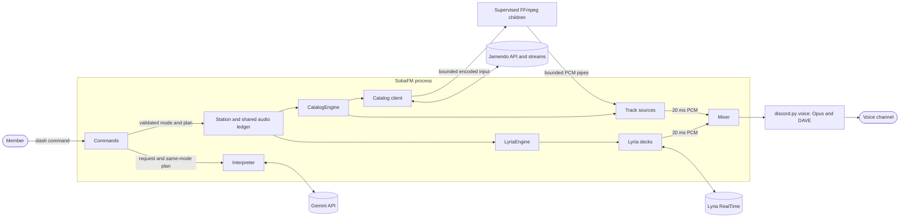

# Architecture

- **Status:** Approved v1 baseline (#5), reconciled with accepted M5 ADR-0006/ADR-0007 (#119); ADR-0009's footprint revision is Proposed and catalog qualification remains outstanding.
- **Requirements:** [requirements.md](requirements.md)
- **Decisions:** [ADR-0001](decisions/0001-build-on-python-discord-py-and-the-google-gen-ai-sdk.md) · [ADR-0002](decisions/0002-interpret-requests-with-gemini-structured-output.md) · [ADR-0003](decisions/0003-keep-server-state-in-sqlite-and-use-discord-command-permissions.md) · [ADR-0004](decisions/0004-stream-lyria-realtime-through-buffered-decks.md) · [ADR-0005](decisions/0005-release-images-with-github-actions-and-artifact-attestations.md) · [ADR-0006](decisions/0006-play-catalog-and-generated-music-in-one-station.md) · [ADR-0007](decisions/0007-bound-catalog-audio-decoding.md) · [ADR-0009](decisions/0009-raise-the-per-server-audio-footprint-ceiling-to-70-mb.md)

## Summary

SobaFM runs one Python bot process built on discord.py, with one **station** and
player per server. The accepted M5 design adds a **LyriaEngine** for generated
`/freestyle` programs and a **CatalogEngine** for Jamendo `/play` programs. Both
feed buffered 20 ms PCM sources into the same **mixer** and share voice recovery,
settings and command admission. Catalog decoding runs in separately supervised
FFmpeg children. Generated-to-generated transitions keep v1's crossfades; every
catalog-involving boundary is successive, without catalog fades or overlap.

The station implements the source/engine seam and shared allocation ledger. The
bounded TrackDeck, native load check, catalog engine and command/credit wiring
are implemented. Production catalog readiness remains unavailable until actual
runtime, containment/allocation and source-notice qualifications exist. The
requirements identify these changes with stable M5 IDs. Accepted historical ADRs
remain intact; ADR-0006/ADR-0007 record the scoped changes.

## Scope

In scope: the [requirements](requirements.md), including the accepted M5 target.
Out of scope: several voice channels per server, horizontal scaling, a hosted
public instance, other catalogs and a provider/plugin framework. One bot process
serves the servers that invite its Discord application.

## Platform constraints

| Constraint | Source | Design response |
| --- | --- | --- |
| Lyria RealTime emits raw 16-bit PCM at 48 kHz in stereo, in chunks of about 2 seconds | [Lyria RealTime guide](https://ai.google.dev/gemini-api/docs/realtime-music-generation) | The format Discord encodes to Opus: chunks are split into 3,840-byte, 20 ms frames with no resampling |
| Audio is generated ahead of playback, and prompt changes affect only audio generated afterwards | Lyria RealTime guide | Every plan change fills a new deck and crossfades to it, instead of steering a session whose audio is already buffered |
| Every config update must include all fields, and `bpm` or `scale` changes need a hard context reset | Lyria RealTime guide | The full config is sent with every new session; tempo and key change only between decks |
| Sessions close after 600 seconds with WebSocket code 1011 and no warning; audio starts a median 2.9 seconds after `play()` | Measured in #11; not in the official documentation | Sessions are retired after 540 seconds; a deck goes live after a 6-second pre-roll |
| Generation averages 0.97× to 0.99× real time per session, with per-minute dips to 0.77× and stalls of up to 17 seconds | Measured in #11 | The next deck fills up to 60 seconds ahead, so the deck taking over can absorb stalls |
| Four concurrent sessions work when started apart; a session started seconds after others can be refused with a `filtered_prompt` | Measured in #11 | Two sessions per playing server; a refused start is retried once after 30 seconds |
| discord.py calls `AudioSource.read()` on its player thread every 20 ms, and an empty result ends playback | [discord.py API reference](https://discordpy.readthedocs.io/en/stable/api.html#discord.AudioSource) | `read()` never blocks and returns silence on underrun |
| Discord accepts only DAVE end-to-end-encrypted voice connections since March 1, 2026 | [Discord change log](https://docs.discord.com/developers/change-log) | discord.py 2.7 with its `voice` extra (ADR-0001) |
| Jamendo stream metadata does not prove actual format, complete transfer, rights or notices | ADR-0006/ADR-0007 and the retained #116 HEAD observations | Validate metadata and actual input/completion separately; qualify useful coverage before catalog readiness |
| Native parsing can fail independently of Python | ADR-0007 | Supervised child, pre-input OS containment, bounded pipes and a shared cleanup owner; resource limits are not a security sandbox |

## Existing-solution review

| Need | Solution | Notes |
| --- | --- | --- |
| Gateway, slash commands, voice, Opus, DAVE | discord.py 2.7 | ADR-0001 |
| Gemini and Lyria RealTime | Google Gen AI SDK | Official SDK; asynchronous `live.music` client |
| Validation and configuration | Pydantic, pydantic-settings | Schema for model output; typed environment settings |
| Gain and mixing | `audioop` (`audioop-lts`) | C implementation, already a discord.py dependency |
| Persistence | Standard library `sqlite3` | ADR-0003 |
| Access control | Discord command permissions | ADR-0003 |
| Continuous playback from Lyria sessions | Custom: decks, mixer, station | No library mixes live PCM streams into a discord.py audio source. Audio servers such as Lavalink play tracks from sources and cannot take a live PCM stream |
| Catalog discovery and streams | Jamendo API v3 | ADR-0006; bounded typed client, per-operator client id and non-commercial terms |
| Incremental MP3 conversion | Minimal shared FFmpeg child | ADR-0007; selected LGPL-2.1-or-later build route, exact supply/source/notices and platform qualification required |

## Design



| Module | Responsibility |
| --- | --- |
| `__main__` | Entry point: configuration, logging, signal handling, and a startup watchdog |
| `config` | Typed settings from the environment and `.env`; secrets held as `SecretStr` |
| `bot` | The discord.py client: intents, command sync, station registry, mode-aware request context/replies, source-bound credits, voice-state events, failed remembered-channel joins and voice recovery |
| `commands` | Slash command handlers: shared request admission, mode routing, deferral and private credit delivery with mentions/previews disabled |
| `catalog_playback` | Qualified catalog composition, shared server history/metadata gate and source-record identity checks; empty defaults remain unavailable |
| `credits` | Complete metadata-only private snapshots, caller-bound pagination and bounded view/delivery ownership |
| `station` | One per server: desired/heard/previous program identity, reconcile loop, listener tracking, transitions, audio ledger and audible-source feedback |
| `program` | Program state, start outcomes and one-time settlement |
| `source`, `engine` | Buffered source and per-mode lifecycle protocols, including source-specific completion/handover and audible settlement |
| `audio_budget` | Per-server allocation envelopes, strict shared byte admission and retained cleanup debt |
| `lyria_engine` | Per-station Lyria deck lifecycle, retries, ready-deck selection and reservations from the shared `SessionPool` |
| `catalog_engine` | Bounded metadata cycles, per-server history, one prepared track and exact-program terminal outcomes |
| `status` | One per server, outliving its stations: the voice channel statuses SobaFM set, and their requests |
| `deck` | One Lyria RealTime session filling a buffer of 20 ms frames, with flow control |
| `track_deck` | One eligible catalog track, strict production outcome, bounded PCM and persistent decoder cleanup ownership |
| `catalog_audio` | One credential-free, non-replayed incremental audio response with counted encoded bytes and verified HTTP EOF |
| `decoder_process` | Fixed pipe-only native launch, pre-input cgroup/Job verification and owned process/pipe release |
| `decoder_check` | Off-loop approved-supply verification and small owned-fixture codec load check; no catalog qualification |
| `mixer` | The `discord.AudioSource`: buffered sources, generated fades/crossfades, successive catalog boundaries and shared volume; no I/O or decoding |
| `pcm` | PCM format constants, the silence frame, and the chunk-to-frame splitter |
| `owned_pcm` | Shared PCM backings/receipts and the public player-cleanup staging boundary |
| `plan` | `MusicPlan` and its mapping to Lyria prompts and the full generation config |
| `interpreter` | Shared Gemini call mechanics with mode-specific validated output, instruction, refusal and fallback policies |
| `failures` | The failures of Gemini and Lyria RealTime a requester can act on, a rejected API key, an exhausted quota, or an outage, and which parts of Google's errors are safe to log |
| `store` | Per-server state in SQLite |

`scripts/lyria_probe.py` measures Lyria RealTime's behavior and is kept so the measurements can be repeated after SDK or model changes.

The table locates existing modules and their target responsibilities. The M5 seam
adds the Lyria/catalog engines, a typed catalog client and bounded track producer;
exact module/type names belong to the implementation issues. The standalone
catalog probe is retained research, not a runtime API or decoder.

### Playback engine

A program carries its mode, validated mode-specific plan/query, requester,
optional monotonic deadline, start future and underrun count. Generated programs
retain their deadline; catalog programs have none (PLAY-2). Identity distinguishes
new requests even when their text is identical. Desired intent can differ from
the program/source still heard while a replacement fills. The station owns
start-result settlement, rollback, player recovery, listener grace, volume and
the combined audio budget (PLAY-1, FB-3, NFR-6).

Each station has one engine per mode. LyriaEngine owns session rotation,
reservations, retry/refusal counters and deferred causes, keyed weakly by program
without values retaining their keys. All Lyria engines share one process-wide
`SessionPool`. CatalogEngine owns validated candidate selection, ordered ready
tracks, bounded recent/failed history and normal completion versus failure.
Catalog work consumes no Lyria slots, but needs shared-byte admission.

The generic station routes each program to its mode's engine. `Program.mode` follows
its validated `MusicPlan` or `CatalogPlan`; only generated programs carry a deadline.
Each request has distinct identity even when it reuses the same plan object.
`LyriaEngine.retry()` owns refusal/backoff/deferred-cause state in a
`WeakKeyDictionary` whose values do not reference the program. Ended-deck tracking
remains a `WeakSet`, with no engine map keyed strongly by source. The operational
logger remains `sobafm.station`.

Production construction always installs Lyria. `/play` is registered only with a
configured Jamendo client ID; normal command sync removes it when omitted and
startup logs a fixed explanation without the ID value. Registration does not
grant readiness. `CatalogPlayback` creates no engine without the exact verified
runtime, qualified supervisor/allocation and independently established complete
source records; neither an absent notice field nor a binary digest supplies that
evidence. Existing unknown Lyria obligations also refuse catalog admission.
`CatalogEngine` takes the server owner's shared history,
audio ledger, catalog client and an unstarted track factory. Offline coordination
also tests the real engine with `FakeCatalog` and fixture-only PCM producers;
Lyria behavior tests retain `FakeLyria` sessions. The source protocol exposes
known failure and strict catalog completion separately from producer-ended state;
a catalog low buffer or exit alone cannot cause a successful handover.

A **source** owns buffered `frames`, diagnostic number, program/plan identity,
producer state, readiness, buffered duration, display title, and lifecycle
operations `start`, `retire`, `wait_ended` and `regulate`. Retirement stops future
production while preserving playable frames; producer-ended is distinct from
playback-drained. Catalog credits accompany the actual source. The mixer's
`FrameSource` remains the smaller `frames: deque[bytes]` contract.

The engine seam covers reserve, count ended, drop ended, retire, generate,
ready-source selection, source-specific `handover_due`, audible settlement and
close. A synchronous terminal poll reports metadata-only failure for an exact
program in the station's existing failure phase. The station snapshots original
targets before FB-3 rollback and recomputes targets before source accounting,
discard and generation. Background selection only stores a bounded result and
wakes the station; it cannot settle requests or drive playback. Engines report
start failures to the station, which owns give-up/rollback.
These are responsibilities, not a generic engine framework or fixed scaffolding.
In particular, a low catalog buffer may mean stalled input, never natural EOF.

For generated music, a **deck** remains one Lyria session filling 20 ms frames.
Keep two non-ended producers, not a fixed number of retained buffers. Session
retirement, stalls and generated plan changes still hand over with the existing
crossfade ([ADR-0004](decisions/0004-stream-lyria-realtime-through-buffered-decks.md)).

Flow control uses only `pause()` and `play()`: a deck pauses generation when it holds 60 seconds of audio and resumes below 45 seconds. The receive loop is never throttled, because unread messages would delay WebSocket keepalive replies.

The **mixer** returns exactly one 3,840-byte frame or silence per `read()`. Generated
crossfades retain equal-power gains and frame-counted progress through voice
reconnection. Gain uses `audioop` and shared smoothed volume; generated fades are
applied only while no catalog audio is audible. At every catalog boundary,
outgoing audio ends before incoming audio starts, with no catalog fade or overlap
(PLAY-9). Underrun/exception still returns silence so the player does not stop on
its own. No mixer read performs HTTP, decoding, pipe I/O, waiting or cleanup.

The station arms a catalog boundary with exact program and player-epoch identity.
For natural succession it may arm after strict outgoing completion, but the
locked player read waits for the final outgoing frame to drain. The next read
selects ready incoming PCM without needing an intervening station tick. Known
incoming failure, disconnection, stop and supersession invalidate the boundary
synchronously. Only a successfully constructed incoming PCM return creates the
bounded handoff receipt; the station consumes that receipt for start settlement,
history, credits and title. Arming or popping the final outgoing frame does not.
A voice transition can invalidate an unaccepted receipt after its read; recovery
requires another valid read in the new context, never acceptance of the stale
receipt. All armed, delivered and live source references retain their existing
audio allocation obligations, including player/mixing copies; this is not proof
that unknown envelopes have been measured or storage has released.

### Catalog track production

`TrackDeck` implements `Source` without selecting tracks or driving station state.
It revalidates one eligible track and keeps that track's immutable credits with
its PCM. `AudioStream` uses a dedicated credential-free aiohttp session, verified
TLS, identity encoding, no redirects and no automatic request replay. It counts
actual bytes before each 16KiB decoder write/drain, rejects advertised or actual
16MiB excess, and distinguishes clean HTTP EOF from a short read.

The supervisor reserves a complete explicit `AudioBytes` envelope and one child
slot before starting. It requires an absolute supply-verified executable, fixed
forced-MP3/pipe-only arguments, minimum environment and verified pre-input cgroup
or Job limits. No feeder becomes reachable before membership and limit readback
succeed. Linux retains its session/cgroup binding sequence and its fixed
executable's no-helper startup premise. Windows creates the child with a
`STARTUPINFOEX` Job list before its initial thread runs, plus an explicit whitelist
of its three inherited stdio endpoints. While suspended, the backend checks the
captured process handle's membership and configured limits, then resumes exactly
once before allowing input. Parent endpoints use overlapped handles adopted by
the public Proactor pipe APIs. Creation and the exact-handle process wait run off
the event loop; cancellation cannot abandon their retained workers or close a
handle still being waited on. Partial setup/adoption and uncertain creation keep
their native argument storage, handles, cleanup debt and admission barrier.
Only positively closed endpoints and completed owned waits can settle that child
ownership. #175 must qualify actual platform behavior; a process group or
whole-container limit is not a substitute for containment.

Windows profiles can provide a positive integer `WindowsJob(commit_limit=...)`
no greater than the unchanged 128 MiB default. Both process and Job commit limits
and kill-on-close are read back during preparation and again after verified
assignment, before input is allowed. This is control plumbing, not a qualified
profile or an audio allowance. A future profile must reserve the entire enforced
ceiling per concurrently owned child, plus independently bounded attributable
startup and outside-commit audio backing; it cannot subtract a measured baseline.
Committed memory is not resident audio, and runtime/code pages are not audio by
definition. Creation-time assignment covers the child's initial-thread work with
the configured Job controls; untouched stdin alone did not provide that guarantee.
It does not prove that every attributable audio allocation is private commit or
close the complete audio accounting requirement. These qualifications remain in
[#175](https://github.com/slackysoba/sobafm/issues/175); no lower production ceiling
or catalog readiness is selected here.

The frame deque never exceeds its admitted capacity. Admission also requires
space for six seconds, or all duration-valid shorter output including the
one-second duration allowance. This prevents an unready source from blocking
before it can verify EOF. Raw samples, strict HTTP and both pipe EOFs, zero exit,
reaping and duration agreement precede the single aligned final padding frame.
`completed` means verified production; `drained` additionally means its deque is
empty, not that mixer/encoder storage has released. A playable prefix followed
by a late error remains failed. Retirement preserves buffered PCM and cannot be
reversed by a stale `start()`.

One original three-second cleanup deadline covers cancellation, concurrent pipe
drains, stdin/HTTP closure, all task joins, terminate/kill and actual tree/handle
release. A missed deadline produces sticky cleanup failure while a supervisor
owner outlives station replacement and continues best-effort closure. Pending
launch, descendants or pipe debt retain the child slot until release is verified.
The retained launch owner constructs its process adapter before creation and
captures the positively returned raw process directly into it before further
calls or suspension. Binding/handoff failure therefore cannot discard that
process. A creation call that fails without a positive owner is uncertain:
task completion, exception type and an empty unassigned boundary are not proof
that no child materialized. Full reservations and debt remain; the affected
supervisor and ledger bar new admission, including queued creation calls.
Only the exact owner's positive release clears its barrier. A positively
never-invoked path can refund its reservation only after prepared resources close.

Stdin closure has one shielded wait owner shared by feeding and cleanup; cancelling
a feeder cannot cancel CPython's shared protocol-close Future.
Encoded input transfers only when its lazy factory returns after successful
child binding. Failed-launch cleanup never invokes that factory; an unused
precreated fixture remains its creator's responsibility. A transferred input
has one retained shielded close operation, separate from stdin closure and
composing with the HTTP owner's close task. A failed or cancelled close cannot
be replaced by a legacy `closed` flag or retried as a new owner to refund debt.
The separate complete audio lease remains charged until its storage owner proves
all covered PCM/player/copy/transport/native allocations released; EOF or deque
pops cannot release it. The later engine must supply that storage proof.

No production `Envelope` is supplied yet. Unknown native/transport or reachable
Lyria obligations refuse admission, even with an empty deque. Startup supply and
owned-fixture capability checks do not fill the trust registry, qualify an audio
envelope, enable commands or satisfy #175/#131. Generated behavior is unchanged.

### Threads and buffers

- The **event loop** runs the gateway, commands, Gemini calls, Lyria sessions, asynchronous catalog HTTP/pipe supervision and the reconcile loop. Store calls run in a worker thread through `asyncio.to_thread`; native MP3 decoding runs in supervised child processes.
- discord.py's **player thread** calls `Mixer.read()` every 20 ms.
- Frames cross between producers and the player through each source's `collections.deque`, whose appends and pops are thread-safe. Source/allocation leases account for retained storage and copies; deque length alone is not the audio budget.
- The mixer's control state (live deck, pending switch, volume) sits behind one `threading.Lock`, held for one read's pops and mixing, tens of microseconds, or for a constant-time update.
- The mixer never calls into the event loop; the station observes it on each tick. The only cross-thread signal is discord.py's `after` callback, delivered with `loop.call_soon_threadsafe`.

The station detaches the original reported player error's traceback, context and
cause in a `finally` around the entire callback. This preserves reporting and
epoch scheduling while releasing exception links to player-frame storage even
if invalidation, logging or scheduling raises. The retained error keeps its
identity; clearing these links alone proves no complete player/native release
and refunds no audio lease.

`FrameSplitter` copies one immutable owned frame at a time from an input view;
it stages neither a whole-input copy nor an output-frame list. Fully consuming
an input leaves an independently copied carry shorter than 3,840 bytes. Each
iterator starts consuming on first advancement and must be exhausted or closed
before another consumes input; overlapping consumption raises an error. Closing
after a yield discards unread input, while closing an unstarted iterator leaves
the carry intact. Deck callers close iterators on early exit, including catalog
cancellation while awaiting room for an emitted frame. A tail-only catalog read
does not wait for room. Generated reception remains synchronous and unthrottled;
only strictly verified catalog EOF permits final padding.

The iterator still retains the caller's original input during consumption, and
queued or caller-retained output frames occupy their own storage. Removing this
assembly spike does not qualify complete audio envelopes or prove storage release;
all source, SDK, transport, player, native and cleanup obligations remain charged
under the shared accounting contract. Production catalog trust remains empty.

### Bounded Lyria ingress failure

The [maintainer choice on #203](https://github.com/slackysoba/sobafm/issues/203#issuecomment-6315404910)
is recorded in [ADR-0008](decisions/0008-fail-lyria-producers-at-qualified-ingress-bounds.md).
The accepted exceptional policy permits
explicit producer failure before accepting input beyond a complete,
derived and pre-reserved ingress allowance after pause. Keep already-admitted
PCM under the existing playout/spare rules and recover through ordinary failure,
retry and fade handling; do not silently trim frames or discard a ready fallback.

The active connector uses ADR-0010's public bounded SDK interface with
`compression=None`; no whole-message fallback is available in SobaFM. One server
ordinarily reserves two 524,288-byte payload stores before allocating them and
before creating unknown Lyria obligations. Every setup and later receive uses
its exclusive store, a 524,288-byte WebSocket message limit, queue high-water mark
of one frame, 64 fragments, eight empty fragments and `ShapeLimits(524288, 1024,
16, 64)`. These are component rejection settings, not observed provider maxima
or a full ingress allowance. The SDK rejects excess before assembly copies or
JSON parsing as applicable. Remaining TLS/socket/JSON/model/decode copies and
overshoot still require their separate complete reservation/qualification.
Preserve admissible paused-session close observation;
the exceptional terminal path need not await a close hidden behind unadmitted
backlog. No complete numerical ingress allowance, private SDK/custom transport or
catalog readiness is selected by these component settings. The normal constants,
strict shared byte limits, single original three-second cleanup budget and
actual-release debt remain unchanged. Unknown obligations stay fail-closed.

### Station reconcile loop

A station stores desired, heard and retained previous program identity. Its
`reconcile()` runs every 250 ms and when woken; it and `close()` alone coordinate
creating, switching and closing sources. Producer tasks only fill buffers. Apply
these rules across retained sources of both modes in this order:

1. **End.** Connection loss, a generated deadline or 60 seconds without listeners clears the program. Catalog programs have no deadline.
2. **Count, give up, then discard.** Count newly ended producers once, preserving per-failure current-program checks after any synchronous FB-3 rollback; do not aggregate all failures before one give-up. Re-read the current plan before dropping ended sources the mixer no longer uses. Preserve Lyria's normal-retirement backoff reset before failure sorting: key/quota, refusals, recognized causes, other failures, including existing tie behavior. A Lyria session that ends early or short of pre-roll is a failure; normal catalog EOF is not. Lyria preserves its most-buffered ended ready spare for the current plan while no open unused deck is ready. Do not apply that spare-discard policy to a normally completed next catalog track.
3. **Retire.** Rotate Lyria at 540 seconds and retire unused obsolete producers in either engine. Preserve the mixer's live/incoming frames; retire an outgoing producer at handover.
4. **Generate.** Preserve Lyria's two non-ended producers, global reservation and backoff rules beside any retained ended audio; closing producers still occupy slots. Key/quota give-up, final-retry give-up and second-refusal give-up all wait while another same-plan deck is open or ended-ready with connected voice. Preserve once-per-round refusal counting and the final decisive cause (#93), including a later quota failure after an outage. Started Lyria programs keep retrying. New catalog work needs shared-byte/child admission and the fixed selection bounds below.
5. **Start.** Select a ready source only with a running player and connected voice. Generated starts keep their fade-in; catalog starts have none. Settle playing/feedback only then. Restart a player discord.py stopped under the existing recovery rules.
6. **Hand over, or stop.** Never start another switch during a switch. Generated-to-generated handover keeps the below-four-second trigger, most-buffered ready choice and clamped four-second equal-power crossfade. Catalog chooses the earliest eligible ready source; normal handover waits for strict completion and final audible drain. Starvation waits/retries rather than becoming success. Prepare explicit skip/replacement before switching. Every catalog-involving boundary ends outgoing audio before incoming audio, without catalog fade/overlap or intentional normal-boundary silence. Without a program retire unused sources, cease catalog audio or finish generated wind-down, then stop/release. Without a player stop at once, since unread fades cannot finish.
7. **Regulate.** Apply source-specific flow control and byte reservations, preserving Lyria's 60/45-second pause/resume behavior.
8. **Feedback.** Publish the accepted audible source, keeping old credits/title while a replacement starts. History changes only on audible settlement. Status failure never stalls playback.

The existing optional status lifecycle remains shared (FB-2). Show the generated
title or catalog song/artist within 500 characters. Sync only while connected;
each tick compares desired/set status so moves and new gateway sessions catch up.
One request runs at a time and is never cancelled. Closing, and `/join` before a
move, wait at most ten seconds for the request in flight and subsequent clear.
Missing permission is checked again every ten seconds; refused requests log once
and retry after ten seconds, doubling to five minutes without affecting playback.

The titles SobaFM set, and its requests, belong to the server rather than to a station, in memory. So they outlive a station that closes before it can clear its title, and requests stay in order across stations. A channel SobaFM was dragged out of, or whose connection it lost, keeps the title, since only someone connected there, or with Manage Channels, can change it. SobaFM clears it once it is connected there again with nothing to show: a station clears it on its next tick, and without one, connecting does. So does the voice check every 10 seconds, which also covers a move back and retries a refused clear. Discord clears an empty channel's status itself, so SobaFM forgets a channel's title once the channel empties, checking at each departure and when the server becomes available again. A status a member sets over SobaFM's title while the channel stays occupied is cleared too, since discord.py doesn't report status changes.

The station never closes a source the mixer still references. Keep #89's immediate
release without cycle collection: weak ended-source tracking, no strong engine
map keyed by source, detached exception tracebacks and consumed cancellation
exceptions. Apply the same rule to catalog tasks/errors so error objects do not
retain encoded audio. Repeated retirement cannot interrupt existing cleanup.

Commands install desired programs and wake the loop. Final supersession checking
and admission/install have no intervening await, so the latest accepted request
wins. The shared cooldown starts before interpretation/selection; only its owning
failed request can free it, including after a reply. Restart clears programs and
the in-memory cooldown (SET-3).

### Cross-mode admission and rollback

Reserve two process-wide Lyria slots per station's Lyria engine, not per program.
Catalog admission uses no Lyria reservation (FB-3, NFR-6):

| Transition | Ownership and failure behavior |
| --- | --- |
| Catalog → generated | Acquire two slots before installing the target. BUSY leaves catalog music/program intact and frees only that failed request's cooldown. Catalog remains heard while Lyria fills; failed startup restores it if viable. |
| Generated → catalog | Keep the generated reservation while the program is desired or retained for FB-3. Retire unused old producers while used audio continues. Failed catalog startup restores the original generated program/deadline/reservation if still viable. |
| Successful departure from generated | Release only when neither desired nor previous program needs Lyria and every producer, including closing/outgoing ones, has ended. Retained ended PCM alone uses no open-session slot. |
| Generated → generated or return before release | Reuse the reservation; count retained/closing producers toward two and never double-reserve. |
| Stop, leave, permanent voice loss, shutdown | Settle pending starts, clear previous state, invalidate work, retire/cancel producers and release once cleanup actually completes. Old completions cannot restart a program. |

Rapid A→B→C replacements retain A if it is still heard, rather than rolling back
to failed B. Never restart an expired generated previous program or a catalog
program invalidated by stop/leave/voice loss. After a replacement plays, recovery
belongs to it rather than an older program. Cancellation invalidates interpretation,
HTTP/decode and delayed replies; cancelling a reply waiter cannot cancel the shared
start future. Session reservations, child capacity and byte leases have distinct
release conditions.

### Constants

Generated constants remain set by ADR-0004 from #11; fades apply only under PLAY-9.

| Constant | Value | Purpose |
| --- | --- | --- |
| Frame | 3,840 bytes | 20 ms of 16-bit, 48 kHz stereo PCM |
| Reconcile tick | 250 ms | Rule evaluation and flow-control checks |
| Pre-roll | 6 s | Generated readiness, about three chunks; catalog short-track exception below |
| Pause and resume thresholds | 60 s and 45 s buffered | Flow control; the next deck stays paused at 60 s until it goes live |
| Session limit | 540 s | Retires sessions before the 600-second limit |
| Hand-over point and crossfade | 4 s remaining and 4 s | Start of a handover, and its length |
| Fade-in and fade-out | 2 s and 3 s | Program start and end |
| Refused-start retry | Once, after 30 s | Separates rate-limited session starts from filtered prompts |
| Session caps | 2 per server; 4 per process | Bounds Lyria usage; two playing servers per API key |
| Connect timeout and backoff | 15 s; 2, 5, then 15 s | Session recovery |
| Empty-channel grace period | 60 s | PLAY-4 |

Sixty seconds is Lyria's pause target, not a proven hard allocation ceiling or a
guarantee every handover has that reserve. A 60-second PCM payload is 11,520,000
bytes; three total 34,560,000 bytes. That arithmetic does not establish worst-case
retention or decoder headroom. Rotation can retain an ended live buffer, ended
ready spare and two replacement producers. The recorded 8/60/2/2-second state
contains four buffers and 13,824,000 payload bytes; it disproves a three-buffer
ceiling without proving an overrun or worst-case compliance.

### Shared audio accounting

NFR-3/NFR-6 require one station-owned byte ledger across both engines. Count every
retained live/incoming/spare/ended/filling source, encoded input, HTTP/pipe/native
storage, assembler tail, temporary copy and overshoot. Aliases of one backing
allocation count once; copies count separately. Reserve allocations and qualified
in-flight growth before retention. Admission must allow for reachable future Lyria
growth while catalog audio can remain retained, rather than today's queue lengths.

Aggregate retained PCM is at most 34,560,000 bytes. Under the footprint revision
in proposed ADR-0009, each qualified profile specifies explicit finite parent and
audited native audio reservations whose combined total stays strictly below
70,000,000 decimal bytes. Parent audio includes PCM and other parent storage;
the permitted parent reservation follows the native obligations still charged.
The previous fixed 38,000,000-byte parent split is replaced by that qualified
split, with no independent parent partition. The child process's 128 MiB
containment limit remains a separate resource boundary, never an audio allowance
or NFR-3 proof. Unknown native or transport bounds refuse catalog readiness.

Source allocation leases and cleanup debt outlive caller cancellation and station
replacement. Refund only after owned tasks, transports, process trees and retained
bytes actually release storage. A timeout or direct-child exit alone releases
neither byte capacity nor child slot. Preserve Lyria's generation and spare rules;
defer/refuse catalog work or reduce catalog prefetch when reservations cannot fit.
No fixed source-count ceiling, suppressed Lyria replacement or discarded playable
fallback may substitute for accounting. If a feasible envelope cannot be proven,
keep catalog unavailable and record a reviewed revision. The selected ceilings
remain unqualified for actual provider/native storage.

`AudioLedger` enforces the strict 70,000,000-byte combined total alongside the
unchanged PCM ceiling. Its retained `PARENT_LIMIT = TOTAL_LIMIT - 1` is only the
derived integer bound; native reservations consume the same total allowance.
These admission guards do not qualify a numerical native/transport envelope or
production profile.
Its immutable `AudioBytes` envelopes cover PCM, other parent audio and audited
native audio.
Owners reserve a complete reachable allocation before production, including
future growth, assembler/transport overshoot and separate copies. Aliases share
the same lease. A fixed envelope also covers a frame popped by the player and
temporary mixing/output copies until their actual release. Neither producer exit,
an empty deque, caller cancellation, a timeout nor garbage collection refunds a
lease. Only verified release by its owner does. `SobaFM.audio_ledgers` retains the
same server ledger across replacement stations; engine cleanup never clears
unrelated leases or outstanding debt.

`reserve_pcm_capacity(n)` admits a positive PCM-only owner through that same
ordinary gate, before unqualified work starts. Its one-level `reserve_pcm(n)`
children borrow only from the parent's precharged maximum; they do not add a
second ledger charge or spend another owner's capacity. Closing child admission
is permanent and preserves existing children. A child's explicit storage-release
acknowledgement returns capacity only to its parent. The parent remains charged
until admission is closed, every child has explicitly released, and its owner
explicitly releases the parent. Zero children alone refund nothing; an open or
borrowed parent refuses release. Flat leases keep their existing behavior.
There is no transfer, replacement adoption or unknown-owner exemption. This
primitive now supplies one retained server PCM owner, admitted for the existing
`PCM_LIMIT` before the Lyria unknown obligation is created. Replacement stations
reuse that same parent and outstanding children. The server ledger keeps the
parent charged; station shutdown cannot close it or mint a successor.
The owner's first child persistently charges the immutable `SILENCE` backing,
once across player epochs and replacement stations. Player cleanup never refunds
this static storage; the four transient staging frames are a separate charge.

`OwnedPCM` couples immutable backing bytes to a receipt. Source queues transfer
that ownership to Mixer reads; aliases share one backing lease with idempotent
acknowledgements, and new copies reserve separate children before allocation. `FrameSplitter` incrementally
prepays carry growth and frame construction, retaining old carry through the
last concatenation use. Deck capacity refusal fails only that producer with a
fixed local resource category, preserving admitted frames and ordinary spare,
pause, retry and fade rules. TrackDeck prepays bounded output/drain reads and
padding. Its declared PCM maximum includes popped borrows, while its ordinary
flat admission still reserves other/native allocations without charging PCM
twice. Missing qualification, unknown debt and supervisor/slot gates still refuse
catalog work. No production decoder envelope is selected.

Retirement preserves queues. Only existing permanent unused-source drop and
detached shutdown paths explicitly discard remaining queue/carry storage;
in-flight reader receipts remain charged. Mixer always constructs separate output
storage, including unity gain, and posts receipt-only acknowledgements after
dropping its input locals. Receipt operations run on the event loop. Before a
player starts, four frame payloads are prepaid for the three possible mixing
copies and the supported caller's previous returned frame. A real AudioSource
wrapper detaches its delegate at successful public `cleanup()` before scheduling
the exact epoch's loop acknowledgement. Stop/after, GC, failed cleanup, a closed
loop and stale callbacks cannot recycle staging. Unknown errors retain staging
and borrowed-input debt; recovery first funds fresh scratch on the loop. This
needs no whole-thread join and never refunds source queues or external storage.

This guard covers owned Python PCM payload/read/carry/padding/queue/borrow and
Mixer/caller staging storage. Python object bookkeeping, SDK response allocation,
audioop/native internals, Opus/crypto and transport allocations remain separate
unqualified obligations. It is not a complete resident-audio or readiness proof.

The server retains the two fixed receive stores and their ordinary ledger charge
across replacement stations. Distinct active receivers cannot share a store;
there is no third fallback allocation. A Deck retains setup, producer, iterator
closure and the exact public SDK context until they actually settle. Retirement,
a local ingress failure and caller cancellation share one original monotonic
three-second cleanup verdict. A late release can end the exclusive borrow but
cannot repair a failed verdict. Failed or uncertain cleanup retains the store,
Deck owner and session reservation; deadline expiry and producer end refund
nothing. Only actual iterator/context quiescence permits paid-store reuse.
Bounded/shape/parse/conversion errors use fixed safe diagnostics without provider
exception graphs. Already-admitted PCM and ordinary retry/spare rules remain.

There is still no qualified complete Lyria receive/copy/transport envelope. Its engine
therefore records an explicit unknown obligation, blocking catalog
admission even when current queues are empty. That debt remains after producer
cleanup and across replacement stations: player stop/callback alone does not
prove that the encoder, transports and returned PCM copies released storage. No
qualified complete release signal is available yet. Normal generated production
and spare retention retain their existing behavior; exceptional owned-PCM
exhaustion follows ADR-0008's explicit producer-failure policy. This fail-closed
gate implements the
accepted unresolved-bound policy, not measured NFR-3 compliance or available
decoder headroom. #125/#127/#175 must supply enforced and qualified producer,
transport/native and reachable-growth bounds before catalog readiness. Synthetic
envelope tests exercise arithmetic and ownership only.

Station shutdown invalidates requests and detaches the mixer before cleanup;
one shielded cleanup task survives repeated caller cancellation. Session slots
release after all Lyria producers actually end and neither desired nor retained
previous intent requires them. Byte leases have their separate storage/cleanup
release condition. Catalog's bounded process cleanup and child-slot ownership
remain with the `DecoderSupervisor` and `TrackDeck` cleanup owners. Removing
sources or completed metadata tasks never refunds their audio storage. Metadata
tasks retain their selection/cursor independently of weak program membership
through cancellation and join. This sequencing adds no claim of a three-second
production cleanup or measured resource result.

### Catalog selection and failure bounds

The catalog client validates HTTP status, Jamendo `headers.status`/code, bounded
response schema, exact license/notices and finite positive duration before stream
fetch (AI-2, USE-4/USE-5). Validate stream URLs and redirect destinations before
forwarding credentials; never give a source URL to FFmpeg. Search sends only
validated descriptive terms/attributes and the operator's client id, without
Discord identifiers. Safe status/cause categories distinguish authorization,
quota/rate limits, outages, malformed responses and successful empty searches.
Provider error envelopes never become empty results or relaxed quota bypasses.

PLAY-12 uses these fixed application bounds, not presumed provider quota:

| Boundary | Limit/policy |
| --- | --- |
| Search relaxation | All tags → any tags (`fuzzytags`) → validated descriptive text; preserve explicit attributes and eligible licenses throughout |
| Results | At most two pages of ten per stage; at most 60 retained records; stop when an eligible non-recent candidate is found |
| Metadata cycle | At most eight attempts total, including two transient retries, ten seconds per attempt within one 30-second cycle; retry recoverable connection/server failures after one then two seconds if time remains; honor Retry-After within that deadline; authorization/quota failures are terminal |
| Metadata body/concurrency | At most 512 KiB including decompression; one call per station/two per process, at most one new call per second process-wide; provider restrictions/backoff take precedence |
| Exhaustion recovery | No tight refill loop; a playing program retries after 15, 30, then 60 seconds, retaining the 60-second ceiling; new accepted requests get their own bounded cycle |
| Stream candidates/prefetch | At most three distinct candidates per cycle under decoder bounds, never two alternatives for one next slot; at most audible plus one prepared catalog track; cleanup completes before capacity reuse |
| History | Last 64 audibly accepted ids per server across programs and replacement stations, expiring after 24 hours; at most 128 failed ids for ten minutes; clear on process restart; independently exclude current/retained/prepared ids; exhaustion reports no eligible non-recent match |

One search cursor owns the original stages, pages, attempts and deadline across
local exclusion and candidate failure. A nonempty provider stage exhausted by
rights/history filters cannot relax into a new stage or gain a fresh budget.
Closing a cursor invalidates further work; the engine separately owns, cancels
and joins any in-flight page task. It retains at most one unplayed source and
revalidates a prepared choice against the actually accepted artist before arming.

Artist avoidance excludes only the last audibly accepted catalog display label,
including across programs, for at most 24 hours. Its complete bounded comparison
key uses Unicode NFKC, collapsed whitespace and casefolding; it is not truncated
and does not claim authoritative performer identity. The 64-track history is
separate from this anti-consecutive rule. Every newly observed failed source
enters the failed-id history, including superseded unheard sources, while retry
counts and terminal outcomes remain exact-program decisions. Exhaustion never
clears history, relaxes artist avoidance or replays the oldest track.

Catalog interpretation failure triggers no raw-text search (AI-4). Initial
search/candidate exhaustion gives a specific failure and FB-3 rollback. A started
program refills/retries while existing buffers play. Invalid rights/notices,
oversize input and decode failures skip one candidate with a sanitized category;
failure after a streamed prefix was heard is still failure, never normal EOF.

Source integration and offline fixtures do not complete live qualification.
The original multi-track live verification remains open in #131 after command
and owner wiring (#128/#129) and applicable supported-platform/resource readiness
(#175). Production native trust remains empty and catalog admission fails closed
until its real prerequisites are met; #132 source/notices/publication is separate.

### Decoder guardrails

ADR-0007 selects incremental MP3 conversion in a separately supervised minimal
shared FFmpeg child (OPS-6, NFR-7/NFR-8). The parent catalog client owns HTTP and
transfer completion. Use an absolute verified executable, fixed argument array
with `asyncio.create_subprocess_exec`, minimum launch environment and no shell.
Credentials/source URLs enter neither arguments nor child environment. Force MP3
input, including supported 44.1 kHz mono/stereo conversion, pipe-only protocols,
first audio stream and 48 kHz stereo `pcm_s16le` output;
disable other streams and decoder network access. No whole-track PCM result,
temporary audio file or `communicate()` output accumulation is allowed.

The fixed invocation sets FFmpeg's public [pipe `blocksize`](https://ffmpeg.org/ffmpeg-protocols.html#pipe)
to 16,384 bytes separately for `pipe:0` input and `pipe:1` output. This caps each
protocol I/O operation, not pipe capacity, kernel memory, stderr, total pending
I/O or the parent's OS read requests and coalesced writes. Completed unread data,
quota growth and pending-I/O bookkeeping still require a qualified envelope;
unknown transport obligations continue to refuse admission.

| Boundary | Selected limit/enforcement |
| --- | --- |
| Encoded input | At most 16 MiB cumulative, counted before writes regardless of Content-Length; retained queue at most 256 KiB per child; writes at most 16 KiB followed by drain |
| Duration/output | Valid positive finite metadata duration at most 900 seconds; at most 43,200,000 stereo sample frames, counted from output bytes divided by four; cap breach fails rather than silently truncates |
| PCM | Reads at most 3,840 bytes, assembled across arbitrary splits; at most 60 seconds per catalog source, reduced/deferred when shared reservations require |
| Pipes | Independently reserve each stdin/stdout/stderr transport within 256 KiB including qualified overshoot/in-flight storage; reader limits alone are flow-control thresholds, not allocation proofs |
| Diagnostics | Drain stderr concurrently; retain at most 4 KiB with a separately bounded transport; emit fixed category/exit status, never raw diagnostics |
| Child containment | At most two children per server/four per process, each 128 MiB; before untrusted input, use delegated unprivileged Linux cgroup v2 with `memory.max` and `memory.swap.max=0`, or an assigned Windows Job Object with process/job memory limits and kill-on-close |
| Progress/lifetime | First PCM within 15 seconds; expected input/output idle limit 15 seconds excluding intentional backpressure; absolute lifetime 1,830 seconds including pauses |
| Cleanup | One total monotonic three-second deadline from first cleanup request; concurrent drain/closure/joins and terminate, wait up to one second, kill if needed and wait up to one further second, all within that same deadline |

Missing verified executable, cgroup delegation, Job assignment or enforcement
refuses catalog readiness with setup guidance; generated availability retains
its behavior. A bot-wide container limit, RSS polling or native `-max_alloc`
does not replace per-child containment. No runtime privilege increase is allowed.
Cap breach fails the child/track without killing the bot; the boundary is not a
general security sandbox.

Cleanup starts bounded draining/discarding while stopping the feeder and
terminating the tree; it does not wait for joins or exit before draining. A single
owner survives repeated/external cancellation without resetting the deadline.
All closure/join/drain/reap waits share it. Descendants may retain pipe handles,
so reaping the direct child does not prove EOF/closure. Any unfinished owned
resource at three seconds is cleanup failure: retain its owner, debt, leases and
child slot across station replacement and block reuse until later supervised
cleanup verifies actual release (NFR-8).

PLAY-10/PLAY-11 distinguish readiness, production completion and audible ending:

1. A source is ready at six seconds of reserved PCM. A shorter positive-duration
   source waits for every strict completion check; never pad it to six seconds.
2. Strict completion needs clean HTTP EOF, agreement with any declared length,
   stdout/stderr EOF and drain, zero exit/reaping, nonempty sample-aligned output and decoded
   duration within one second of validated metadata before padding. Missing/invalid
   duration, transfer truncation and zero-exit short output fail the track.
3. At verified normal EOF, a four-byte-aligned partial frame may be padded once
   to 3,840 bytes, charged within byte/sample limits. Incomplete stereo samples
   fail. Ordinary short reads never imply EOF or frame alignment.
4. A normal performance ends only after strict completion and consumption of
   remaining PCM. Six-second readiness can precede full verification; a late error
   remains failure with retained ownership and bounded recovery even if a prefix
   was heard. Feedback never claims full completion or retrospectively removes it.

These guardrails and the one-second tolerance are selected targets requiring
actual supported-input/platform qualification, not results from #116's HEAD data.

### Interpreter

The interpreter remains SobaFM's only Gemini stage, with shared call mechanics
and mode-specific instructions/schema (AI-1 to AI-7). Each accepted `/play` or
`/freestyle` makes one call; `/skip` reuses the catalog program without a model
call. Send request text and only the same-mode current plan as data. A cross-mode
request starts fresh, with that limitation explained. Validate before a source
action. Both modes translate artist/work names into descriptive terms and reject
non-music/injection classifications or safety refusals without source calls.

`Interpreter[P]` shares the call, ten-second timeout, safety checks, validation and
redacted failure logging. A `Task[P]` supplies the instruction, the Pydantic
`Interpretation[P]` answer model, a failure policy returning `Result[P]`, and a
refinement merge. `GENERATED_TASK` holds the existing generated instruction,
`MusicPlan` answer, raw-text fallback and merge of omitted/unset `KEPT_FIELDS`.
The two-argument `Interpreter(client, model)` still selects this task; another
task is passed as the third argument. The generated instruction and schema sent
to Gemini remain unchanged. Shared configuration keeps minimal thinking, tools
disabled and the existing no-redirect HTTP options.

`CATALOG_TASK` returns `UNAVAILABLE` with no plan and the safe failure category,
allowing its caller to preserve current music without creating a raw-text query.
Task-specific configuration stays with each interpreter instance. Search,
playback and command wiring are separate from interpretation.

The generated interpreter preserves ADR-0002's behavior:

- **Input:** the request text and the current plan, sent as data in the user turn. The system instruction distills the [Lyria prompt guide](https://ai.google.dev/gemini-api/docs/lyria-prompt-guide), asks for instrumental descriptors in English, and has names of artists and works translated into descriptive terms.
- **Output:** JSON constrained by the schema below through [structured output](https://ai.google.dev/gemini-api/docs/structured-output), then validated with Pydantic.
- **Policy:** `not_music`, safety-blocked, and blank requests are refused. Any other failure, such as a timeout (10 seconds), a rejected API key, a rate limit, a server error, a connection failure, or invalid output, falls back to the request text, truncated to 120 characters: added at weight 0.5 to the current plan when music is playing (the lowest-weight prompt makes room if the plan has four), and as the only prompt otherwise. The reply names an exhausted quota or an outage as the cause. Lyria RealTime uses the same key, so it reports a rejected key itself. For `refine`, the values an answer leaves out or unset are copied from the current plan: tempo, key, density, brightness, drum muting, and wordless vocals. API errors are logged by code, status, and error reason, never by message, since Gemini's messages can quote the API key. Other failures are logged by exception type, with a traceback when unexpected.
- **Model:** `gemini-3.5-flash-lite` by default, set with `SOBAFM_GEMINI_MODEL`. The call uses the minimal thinking level and no tools; sampling parameters are not sent.

```python
class Prompt(BaseModel):
    text: str  # 1 to 120 characters, with whitespace collapsed and bidirectional controls dropped
    weight: float  # 0.1 to 1.0


class MusicPlan(BaseModel):
    title: str  # 1 to 60 characters, with whitespace collapsed and bidirectional controls dropped
    prompts: list[Prompt]  # 1 to 4 prompts
    bpm: int | None  # 60 to 200
    scale: Scale | None  # the SDK's scale enum
    density: float | None  # 0.0 to 1.0
    brightness: float | None  # 0.0 to 1.0
    mute_drums: bool
    vocalization: bool  # wordless vocals


class Interpretation(BaseModel):
    kind: Literal["new", "refine", "not_music"]
    plan: MusicPlan | None  # None only when kind is "not_music"
```

`MusicPlan.to_config()` always builds the complete Lyria config. Guidance (4.0), temperature (1.1), and top-k (40) stay at Lyria's defaults, the mode is `QUALITY` (or `VOCALIZATION` for wordless vocals), and no seed is set.

The catalog task produces an immutable `CatalogPlan(title, query)` in the shared
`Interpretation[CatalogPlan]` envelope. Its title is one normalized line of 1–60
characters. `query` is the existing immutable `CatalogQuery`: one to six distinct
lowercase English tags (at most 40 characters each), optional descriptive search
text (at most 120 characters), and optional `speed` (`verylow`, `low`, `medium`,
`high`, `veryhigh`), `vocalinstrumental` (`vocal`, `instrumental`) and
`acousticelectric` (`acoustic`, `electric`). Existing query validation rejects
unsupported fields, URLs and malformed values. Program metadata never becomes a
second discovery-query type: a future engine passes `plan.query` to the client.
All-tags → any-tags → descriptive-text matching remains the client's fixed
bounded sequence; Gemini neither selects a stage nor returns a matching-mode knob.

Every music answer supplies a title and tags. Refinements repeat unchanged tags
and preserve optional query values omitted or left null; explicit valid values
replace them. New requests do not inherit unrelated current filters. The
instruction translates artist/work references into descriptive musical traits
and treats both the request and same-mode current plan as untrusted data. It does
not promise exact BPM, key, drum removal or wordless recordings. Error, timeout or
invalid output reports interpretation unavailable, preserves heard music and makes
no raw-text search. Only a successful valid query reaches bounded relaxation;
explicit attributes/eligible-license constraints remain throughout.

The opt-in catalog evaluation has 38 fresh cases and 63 property checks. Its gates
require valid output for every case, all eight non-music/injection controls refused,
no referenced artist/work names in title/tags/search, all nine focused properties
in the four piano/lo-fi and synthwave cases passing, and at least 90% of all 101
classification/property checks passing. These focused cases carry #116's first-ten
weak-fit feedback forward without inventing case/track ratings or a D1 numerical
relevance pass. Generated evaluation targets and frozen research stay unchanged;
neither evaluation searches the catalog or measures audible fit.

### Quiet catalog credits

CMD-3, ACC-5 and FB-1/FB-2/FB-4 to FB-7 implement the accepted quiet presentation:
per-channel song/artist status and complete private `/now` credits, with no
automatic per-track chat posts, new Send Messages permission or mandatory status
permission. Program title and song title are distinct. Profile presence has no
per-guild target and cannot represent independent songs in different servers.

Build an immutable source-bound snapshot before admission. Include the actual
title, supplied creators/designated attribution parties, exact license/version/URI,
Jamendo provider credit, validated direct track backlink and every required
supplied copyright/license/disclaimer notice and associated licensor link. Reject
missing/conflicting required information or unsafe/incomplete rendering; the
discovery API's four basic fields do not prove complete notices. Preserve any
modification credit required by the permitted use. Escape third-party text, remove
bidi controls and disable mentions/previews while preserving validated usable
links. Build Jamendo/license/provider links from exact validated identities;
licensor links must be bounded credential-free HTTP(S), without userinfo, controls
or private/local destinations. Never fetch arbitrary licensor URLs just to render
them. Required credit cannot be shortened like a status summary.

| Credit/view boundary | Contract |
| --- | --- |
| Complete record/rendering | At most 32 KiB raw UTF-8 and 16,000 escaped UTF-16 code units; reject the track if required information cannot fit safely and completely |
| Pages | At most ten, each at most 1,900 UTF-16 units including labels; never split a link; page one is a private reply with caller-bound previous/next buttons |
| Views | One per caller/server; at most 16 per server/64 per process; expire or evict the oldest within ten minutes; label song and snapshot time; expired navigation requests a new `/now`; release metadata on station shutdown |
| Interactions | Acknowledge/defer within three seconds; private edits/errors only, library rate limits, no retry beyond view lifetime, tokens/interaction objects neither logged nor persisted |
| Listener access | Guild-only `/now` adds no manager/voice-membership check; operators verify an accessible permitted invocation channel for ordinary listeners; no public fallback |

Update credits and recent history when the connected player accepts an audible
source, including each track in one program. `Program.first_credit` keeps only
the initial accepted record for a delayed initial reply; `/now` snapshots the
current accepted source with exact guild/voice ownership. Pending/failed targets leave heard
credits intact; cancelled/stale/disconnected completions cannot publish the next
song. Initial replies describe actual accepted audio and its credit but cannot
serve as a durable later-track updater. Old private pages are labeled snapshots,
never presented as the current song. Status remains optional even when stale,
overwritten or unavailable; it neither replaces the private route nor stops
playback. A known inaccessible/incomplete private route requires correction before
the deployment can qualify. Actual-source notice ingestion, safe links, pagination
and desktop/mobile readability remain qualification gates. `credits` stores only
rendered metadata and a snapshot time, never an audio Source, Station or token.
Initial delivery/navigation and one additional busy or rejection acknowledgement
have explicit cancellation owners and the same absolute ten-minute deadline,
including time in the library rate limiter. Further callbacks do not enqueue
edits or acknowledgements. Expired controls start no new request; the page footer
already directs a fresh `/now`.
Shutdown/eviction releases those pages and cancels pending delivery without a
public fallback or application retry. Generated instructions and fallback remain
unchanged; catalog interpretation failures never use raw-input generated fallback.

The source-integration sequence recorded on #128 (comment 6305298756) leaves
actual `/play`, track changes, private `/now` and mode-switch verification open
in #131 after its prerequisites. Source-notice, listener access, mobile readability
and optional-status qualification remain in #175/#130. Fixture-only tests do not
enable production readiness or establish any live/resource pass.

No catalog overlap is permitted. If a future rights-backed decision permits it,
both audible tracks would need full credits until outgoing audio ends; this
conditional obligation grants no overlap permission.

## Data model

```sql
CREATE TABLE guild (
    guild_id   INTEGER PRIMARY KEY,
    channel_id INTEGER,           -- remembered voice channel, or NULL
    settings   TEXT    NOT NULL,  -- GuildSettings as JSON
    updated_at TEXT    NOT NULL   -- ISO 8601, UTC
);
```

`GuildSettings` is a Pydantic model with the defaults and ranges in [SET-1 to SET-3](requirements.md#settings). Missing fields take their defaults and unknown fields are ignored, so adding a setting needs no migration. A stored setting that no longer validates falls back to its default, with a warning that names it.

Duration applies only to generated programs; volume and cooldown span both modes.
Programs, reservations, byte leases/cleanup debt, audio, recent/failed ids and
credit snapshots/views remain in memory. Restart resumes neither mode. Bound
credit metadata separately from audio; no stream URL, interaction object or token
is persisted (OPS-5, USE-6).

## Interfaces

**Slash commands** are specified in the [requirements](requirements.md#commands).

During the #123 migration, `/freestyle request:<text>` and `/play request:<text>`
both explicitly request generated music through the same handler. Both retain
the 1–200 character option, Google disclosure, voice checks, server-wide cooldown,
public result and slow-start edit. A cancelled deferral releases only its own
cooldown. `/play` stays available until #128 replaces it with the catalog command;
the configuration-aware registration rule below is the M5 target for that step.

`SobaFM.play()` takes a mode and selects mode-specific failure replies. Catalog
requests remain unavailable without interpretation or source work until #128;
they preserve current music and release their own cooldown. Generated requests
send only a current `MusicPlan` to Gemini. If a catalog program exists, a generated
request starts fresh, including raw-text fallback, and its reply explains this
context limit. Generated descriptions retain their deadline; catalog descriptions
show query direction without a generated deadline. Full source-bound catalog
credits and heard-source presentation remain #128's responsibility.

**Configuration** comes from environment variables or a `.env` file:

| Variable | Required | Default | Purpose |
| --- | --- | --- | --- |
| `DISCORD_TOKEN` | Yes | None | Discord bot token |
| `GEMINI_API_KEY` | Yes | None | Gemini API key, used for interpretation and Lyria RealTime |
| `SOBAFM_GEMINI_MODEL` | No | `gemini-3.5-flash-lite` | Interpreter model |
| `SOBAFM_DATA_DIR` | No | `./data` | Directory for the SQLite database |
| `SOBAFM_LOG_LEVEL` | No | `INFO` | Log level |
| `SOBAFM_DEV_GUILD_ID` | No | None | Registers commands to one server for development |
| `SOBAFM_MAX_SESSIONS` | No | `4` | Global cap on concurrent Lyria RealTime sessions, an even number: each playing server reserves two |
| `SOBAFM_JAMENDO_CLIENT_ID` | No | None | Runtime Jamendo application client id, held as `SecretStr` and validated like the Gemini key; catalog additionally requires qualified runtime readiness |

Without catalog configuration, synchronization omits/removes `/play` and `/skip`
and logs a fixed startup explanation, retaining `/freestyle`. Never use generated
music as a silent `/play` fallback (CMD-9, OPS-1). The standalone probe keeps
`JAMENDO_CLIENT_ID`; it is not an alternate runtime spelling.

**Discord invitation:** scopes `bot` and `applications.commands`; View Channel,
Connect and Speak, with optional Set Voice Channel Status for best-effort status.
No new Send Messages or mandatory Manage Channels permission is introduced.
`/play`, `/freestyle`, `/skip` and `/stop` share ACC-2's voice rule; `/now` adds no
manager or voice-membership check, while operators verify listener command access.

## State and lifecycle

- **Request:** admitted by `/play` or `/freestyle`, then interpreted by Gemini with same-mode context only. While interpretation runs, the first newer request to reach the station ends it as replaced. `/skip` uses the current catalog query without a new model call. `/stop`, `/leave`, channel loss and shutdown invalidate pending interpretation/selection/decode/replies. A refusal ends no heard program; latest accepted intent wins under identity/supersession checks.
- **Skip:** shares voice admission and the change cooldown, captures exact station/program/heard-source/player identity before acknowledgement, then uses only the existing eligible ready prefetch. An unready/absent/failed replacement returns an admitted unsuccessful outcome immediately, leaves original preparation and outgoing audio intact, and releases only that request's cooldown. It creates no model call, search cycle, query budget or delayed skip queue. Natural advancement or voice/program replacement invalidates the captured target. A ready skip arms a successive boundary without waiting for outgoing completion/drain; the connected player's first actual incoming PCM settles success/history/credits and retires outgoing, with no fade/overlap. Withdrawal atomically consumes an already-delivered receipt or removes only the exact pending arm. A stalled player's wait expires at 75 seconds and withdraws terminally, rather than leaving a late cutover/announcement. Pending/failed skips keep heard credits; source/lease/child/debt retention is unchanged. The [#129 source/live sequence](https://github.com/slackysoba/sobafm/issues/129#issuecomment-6308427461) keeps real skip/latency checks mandatory and unmeasured in #131/#175; fixture success is not audible or resource qualification.
- **Program:** created by an accepted mode request and replaced by the next one. Generated end time remains duration from station acceptance, including startup time; catalog has no deadline. Stop/leave, empty-channel grace and voice loss end either mode. Failed replacement restores the still-heard program only if viable, preserving a generated deadline. `/now` distinguishes starting intent and heard audio. Retain the slow-start answer after 75 seconds and its terminal edit within the interaction's 15-minute lifetime (FB-1); this is a reporting threshold, not a catalog latency target or durable later-track credit updater.
- **Deck:** `connecting`, then `generating` (paused or not), then `ended` with a reason: retired, closed, failed, or filtered. A deck records the close code when Lyria closes its session with a close frame, including a refusal during setup, which ends the deck as failed. A deck is ready once it holds the pre-roll. Its generation rate is audio seconds received per unpaused wall-clock second, measured after 10 seconds.
- **Catalog source:** selects validated metadata/credits, owns HTTP and one bounded decoder child, becomes ready under PLAY-11, then ends production only after strict completion or a categorized failure. Producer completion does not consume buffered audio or release its storage. Audible drain, cleanup completion and lease/slot release are separate events; ordinary EOF never enters Lyria failure counters.
- **Startup:** load and validate configuration, check that the Opus library loads, open the store, connect to the gateway, and sync commands. Each server's remembered channel is rejoined silently when that server becomes available: at startup, after a new gateway session, or when an outage ends. One recovery task owns the initial attempt and retries 30 seconds after each failed attempt finishes, until connected, the channel is forgotten, the server is removed, or shutdown starts. Each attempt resolves the current server and latest remembered channel and checks permissions; an unavailable server waits for its cache to return. Programs and model sessions do not resume. The watchdog exits with an error if the gateway is not ready within 120 seconds, so the process supervisor restarts SobaFM.
- **Shutdown:** on `SIGTERM`, prevent new recoveries, stop the voice check, cancel and await all owned recovery attempts and delays (including departure waits that swallow cancellation), drop pending edits of slow-start answers, end the requests being interpreted, close each station, which ends its Lyria sessions and clears its voice channel status, waiting up to 10 seconds for Discord, then disconnect from voice and close the client. Each connection attempt retains its exact client across Gateway registry resets. Closing first cancels and awaits in-flight move/server callbacks that can create workers, then drains that client's connector and runner and completes library transport/reader cleanup before propagating cancellation, including repeated cancellation. An obsolete client closes its own transports without sending a guild-wide leave that could disconnect a replacement.

Startup additionally checks qualified catalog executable/supply, containment and
accounting prerequisites without changing generated startup availability (OPS-8).
Station shutdown cancels catalog HTTP/decode/prefetch and private views under the
single three-second owned cleanup contract; unresolved resources retain debt and
supervision rather than receiving fresh timeouts. The existing ten-second Discord
status-clear bound is separate from the decoder's total cleanup budget.

## Failure behavior

| Failure | Behavior |
| --- | --- |
| Generated interpretation timeout, rejected API key, rate limit, server error, connection failure, or invalid output | Preserve the raw-text fallback within generated context and explain it, naming quota/outage as applicable; Lyria reports its rejected key |
| Catalog interpretation timeout/error/invalid output | Report interpretation unavailable, preserve heard music and make no raw-text search |
| Non-music/injection classification or Gemini safety block | Refuse with a short explanation; no catalog search or new generation |
| Catalog empty results | Bounded all-tags/any-tags/descriptive relaxation with explicit constraints, then no eligible match and FB-3; never loop without backoff |
| Jamendo invalid client id, quota/rate limit, outage or malformed envelope | Distinct safe category, bounded recoverable retries; no error-as-empty conversion or filter relaxation to bypass restrictions |
| Ineligible rights/notices, stream/decode error, zero-exit truncation, byte/sample/time cap | Fail/skip that distinct candidate within bounds; before audible switch retain the heard source, after a prefix was heard record a failed track and recover rather than claim completion |
| Missing/unqualified catalog supply, containment or resource/completion prerequisite | Catalog unavailable with actionable setup guidance; generated behavior remains available |
| Decoder cleanup deadline exceeded or inherited pipe/tree still present | Cleanup failure with retained owner/debt/leases/slot until actual release; replacement cannot reuse that capacity |
| Lyria filters a prompt | Discard the new deck, keep the current music, and tell the requester |
| Lyria rejects the API key, or the quota is exhausted | Report it at once with a specific reply, since retrying within seconds can't help, unless another deck may still start the program. A failed replacement keeps the current music. Both causes are recognized from a refused upgrade's status, 401 or 403 for the key and 429 for the quota, or from the close's reason. A reason that is a token, such as `RESOURCE_EXHAUSTED`, is logged; free text is matched but never logged. Google's live APIs are reported to signal an exhausted quota only in the reason, with the code `1011` that outages also use, and the key's rejection came with code `1007` |
| Lyria session closes during a program | Its buffer keeps playing while a replacement deck fills, opened after the backoff. Failed sessions are retried after 2, 5, then every 15 seconds, and after 2 again once a session lasts until SobaFM retires it; a program that has not started yet reports the failure after the third retry, once no other deck of its plan can still start it, with the cause of the session that ended it: an outage when the connection failed, the upgrade was refused with a 5xx status, or Lyria closed with `1006`, `1011`, or `1013`, a rejected key, or an exhausted quota, and otherwise a generic failure |
| Generation stalls or slows | The live deck's buffer absorbs it; below 4 seconds, the station hands over to the next deck. Remaining underruns play silence and are logged: a warning when the live deck runs dry while a program is heard, the silence's length once audio has played again for a second, and each program's total underrun when it stops being heard |
| Lyria refuses a new session's start (`filtered_prompt` with no audio) | Retry once after 30 seconds, then report the prompt as filtered |
| No Lyria session capacity left in the process | Each station's Lyria engine reserves two sessions; BUSY leaves the heard catalog program intact and releases only the failed request's cooldown |
| Voice reconnection | discord.py reconnects; reads pause, flow control pauses generation, and crossfades resume intact. If the player thread gives up first, a playing station starts a new one once voice is back. A fade-in or handover, which reports a request as playing, waits until voice is connected. During a network outage, discord.py can stop reconnecting without cleaning up its voice client. SobaFM checks every 10 seconds for a client with no connection task. Once one stays that way for 60 seconds, twice discord.py's websocket close timeout, SobaFM ends any program as disconnected, closes the client, and rejoins the remembered channel. Availability and stranded-client recovery share one task per server and the voice lock with `/join` and `/leave`. Both retry 30 seconds after each failed attempt finishes, including cleanup, until connected, forgotten, removed, or shutting down. When Discord does not answer, an attempt holds the voice lock for about a minute: discord.py's 30-second handshake timeout, then its 30-second wait to leave. Commands wait on that attempt and retries can start about 90 seconds apart |
| SobaFM moved, disconnected, or its channel deleted | Adopt the new channel, or end the program and forget the channel (PLAY-7). Discord reports every disconnect alike, so a voice connection that discord.py gives up reconnecting is also forgotten. A move or a voice server change after one of discord.py's own reconnects keeps the connection: SobaFM clears the flag discord.py leaves set, which would make it end the connection. A move or voice server change during the connection handshake restarts discord.py's connector, and SobaFM waits for it before judging the connection |
| New gateway session (a reconnect that cannot resume) | discord.py forgets its voice clients, so the program ends. SobaFM explicitly ends requests and the station owned by the old guild/client as disconnected before rejoining, so a fast handshake cannot resume the old program. A current replacement station/client is preserved. Obsolete callbacks and workers are drained and their transports closed locally, without sending a departure on the new Gateway or waiting for its confirmation; the current remembered channel is then rejoined silently using the startup retry loop |
| Player thread error | The `after` callback tells the station, which starts a new player while a program plays, at most once a second. If discord.py cannot start a player for a reason other than a missing voice connection, the program ends. Errors inside `read()` return silence and are logged once per run |
| Gateway not ready at startup | The watchdog exits with an error and the process supervisor restarts SobaFM |
| Opus library missing or unloadable | SobaFM exits at startup with a message that names the library |

## Security and privacy

- **Secrets** come only from the environment, are held as `SecretStr`, and are never logged. `.env` files are git-ignored. Connections to Gemini and Lyria RealTime follow no redirects, since the SDK sends the API key in a header that a redirect would take to another server.
- **Provider data:** request text and only the same-mode current plan go to Gemini; prompts/config go to Lyria; validated descriptive terms/attributes plus the operator's client id go to Jamendo. Send no Discord identifiers. Google free-tier prompt review and operator privacy-policy/service obligations remain disclosed (AI-6, USE-1/USE-2/USE-4).
- **Untrusted input:** validate model output, catalog metadata, exact rights/notices, durations, URLs and actual decoder output before state/action. Escape model/third-party text, remove bidi controls and disable mentions/previews. Preserve only validated usable application-rendered credit links, with complete required information under FB-5/FB-6; status summaries may be shortened. Nothing is executed from requests/metadata.
- **Prompt injection:** the instruction treats the request as data, and the schema limits what any request can produce.
- **Least privilege:** two non-privileged gateway intents; View Channel, Connect and Speak, with optional status permission. No new Send Messages/Manage Channels requirement, decoder privilege escalation or unqualified host-wide containment substitute.
- **Logs:** request text appears only at debug level. Gemini's error statuses and reasons, and Lyria's close reasons, are logged only when they are tokens such as `RESOURCE_EXHAUSTED`, since free text could quote the API key. A frame from Lyria that the SDK can't parse or validate, or an unexpected audio format, is logged by a fixed description, without its content. A failed WebSocket handshake, or a redirect, is logged by the error's type and any status code, without the server's text. Lyria's close reasons are matched for a rejected API key or an exhausted quota, and a deck's summary names the cause of a session that ended short of the pre-roll. `SOBAFM_LOG_LEVEL` applies to SobaFM's own loggers: libraries stay at INFO, since at DEBUG the websockets library logs request headers, which carry the API key. The Google Gen AI SDK logs only warnings and errors, since at INFO it logs Lyria RealTime's setup reply verbatim. Python warnings are logged too, except two of the SDK's: its warning about an unknown enum value in any response, which quotes the value Lyria or Gemini sent, and its expected warning that Lyria RealTime is experimental.

Catalog logs/replies use fixed/allowlisted failure categories, status/exit codes
and sanitized identities, never client ids, credential-bearing URLs/query strings,
raw HTTP bodies, third-party error text or native diagnostics. Interaction
tokens/objects enter neither logs nor persistence. Keep library logging from
exposing request headers/URLs (OPS-5). Decode errors detach tracebacks and release
owned audio when lifecycle/cleanup actually permits, rather than retaining it in
exceptions or reports.

## Catalog rights and service boundary

USE-4 to USE-6 implement ADR-0006's selected policy: exact CC BY, BY-NC, BY-ND,
BY-NC-ND, BY-SA and BY-NC-SA **3.0 Unported**, with actual track rights and all
required supplied notices. Unknown versions, jurisdictional ports, conflicting
metadata or known unavailable required notices reject a candidate. The
[reviewed legal-code table](decisions/0006-play-catalog-and-generated-music-in-one-station.md#selected-catalog-rights-and-playback-policy)
records the selected interpretation; a generic API license flag is insufficient.

All catalog audio plays as successive separate performances with no automated
fade/overlap; explicit skip/replacement/stop ceases the performance, and ordinary
non-clipping volume remains available. No catalog remixing, expressive editing,
loops, time/pitch changes or loudness processing is introduced. Necessary decode/
transport conversion grants no further adaptation rights. ShareAlike does not
automatically license the bot or independent generated works. This is the accepted
implementation interpretation, not universal legal clearance; resolve concrete
rights conflicts before using affected candidates. Retain encrypted Discord/DAVE
transport without adding restrictions denying listeners their CC rights.

Jamendo's selected free API path requires non-commercial deployment even when a
track permits commercial use, per-application registration/protected credentials,
creator/provider credit/direct backlinks, an appropriate privacy policy and
operationally necessary bounded caching. Advertising, affiliate revenue or paid
access cannot be assumed eligible. Operators verify current service/deployment
eligibility; no new paid agreement or availability guarantee is implied. Audio
stays in transient in-memory streaming buffers, never downloads, temporary audio
files, retained replay or offline caches; imply no endorsement.

PLAY-9 explicitly replaces the original M5 #114 outcome/criteria 2/4 crossfades
and #117 ND fades with successive catalog boundaries. Preserve those historical
criteria/dispositions rather than claim they passed. Generated transitions,
60-minute playback with at most two seconds underrun, strict NFR-3, supported
platforms and other unaffected criteria remain unchanged.

## Testing

| Level | Scope | Tooling |
| --- | --- | --- |
| Unit | Existing framing, mixer gains, generated plan/config and store; M5 catalog schema/envelope/license/notice/link validation and bounded rendering | pytest |
| Component | Existing fake-Lyria/clock station/deck and command tests; M5 fake HTTP/decoder/source tests for shared ownership, EOF/readiness/failure, leases/cleanup and actual-source feedback | pytest, pytest-asyncio; owned/generated audio fixtures |
| Evaluation | Existing 38 generated interpreter cases retain their property checks and 90% target; separate catalog interpretation/search cases include weak-fit follow-through and same-mode context/refusal controls | `pytest -m eval` with operator credentials, opt-in and outside CI |
| Platform qualification | Exact native package/installation identities, pre-input containment, shared resource accounting, cancellation/completion and source/credit integration | #174/#175 native supported-platform checks, with incomplete/emulated results labeled |
| Live | Lyria behavior comparison, catalog start/skip latency, successive boundaries and the 60-minute endurance/operational checks after prerequisites | Existing probes/soak tools and private Discord server under the issue's authorized protocol |

The M5 matrix is required follow-on verification, not tests/results delivered by
this documentation update. Preserve Lyria test behavior/constants/log lines while
extracting #120; #121 may make fixture-only adjustments. Cover #89 immediate
release with cycle collection disabled and #93 final-retry/second-refusal/later-
quota give-up ordering. Include the ended live/spare plus two replacement-producer
state without imposing a count ceiling.

Station/engine tests cover BUSY and rollback both ways, original generated
deadlines, rapid replacements, stale completions, voice pauses and stop/leave/
disconnect while interpreting, filling or transitioning. Resource tests cover
copies versus aliases, reachable future Lyria growth/receive overshoot, native/
transport storage and debt across station replacement. Decoder tests include
malformed/oversized/stalled input, arbitrary pipe splits, missing duration,
zero-exit truncation, strict short-track readiness, one-time padding, late audible
failure, repeated/external cancellation and descendant/inherited-pipe cleanup.
Credit tests cover complete supplied notices, safe usable links, bounded private
pages, ordinary-listener access, stale/expired snapshots, desktop/mobile display
and missing/failed status. No bot/provider/native run is implied by the matrix.

### Qualification and evidence

Accepted decisions and these requirements authorize implementation in dependency
order. Actual implementation proof gates catalog readiness/shipping rather than
circularly preventing work from starting (OPS-8):

| Work/evidence | Dependencies and gate |
| --- | --- |
| #119 requirements/architecture | Accepted #117/#118; identifies the M5 target before dependent runtime implementation |
| [#174 native supply](https://github.com/slackysoba/sobafm/issues/174) | Depends on #118/#119; compiler-free exact packages, component/source/notices correspondence, independent rebuild/replacement and distribution access; gates #125 production readiness/#132 shipping |
| #121/#124/#125/#127 implementation | Shared ledger/station, client, producer and engine enforce the adopted bounds and failure contracts under their own dependencies; completed #175 is not a prerequisite to implementing its subjects |
| [#175 supported-platform/resource qualification](https://github.com/slackysoba/sobafm/issues/175) | Depends on #119/#121/#124/#125/#174; relevant #127 admission/recovery and #128 listener-credit integration must exist for those checks; qualifies native platforms, containment, complete accounting, cleanup/completion and useful actual input; gates catalog readiness/#131/#132 |
| #128/#130 credits and guide | Verify actual-source notice ingestion, full private access/links/pages and status failure behavior for intended listeners; a known unavailable route cannot qualify a deployment |
| #131 endurance/latency | Measure catalog `/play` and `/skip` separately under NFR-5, generated `/freestyle` under preserved NFR-1, 60 minutes/at most two seconds underrun under NFR-2 and strict NFR-3; prerequisites remain mandatory |
| #132 release | Applicable supply/platform/resource/credit/guide/soak results plus existing release authority; no readiness or shipping based only on this documentation or historical stable-image checks |

The [catalog latency disposition](https://github.com/slackysoba/sobafm/issues/119#issuecomment-6198444360)
selects a median of at most 15 seconds for each admitted `/play` and `/skip`,
measured separately to first audible catalog/replacement frame under normal
service conditions. Access/cooldown rejections are not admitted; report admitted
failures/timeouts separately without treating them as successes or hiding them.
These are unmeasured M5 targets. Preserve generated `/freestyle`'s existing
15-second median and its historical evidence/limits. The 30-second metadata-cycle
bound, subsequent 15-second first-PCM deadline and 75-second slow-start feedback
threshold are separate failure/reporting limits, not latency passes.

Issue #116 was accepted qualitatively with structured ratings/export and calculated
go/no-go waived. Frozen ratings stay null and the 28/42 audible-fit mark remains
unmeasured; the missed original deadline remains recorded. HEAD observations are
not audio GET/format/completion/resource evidence. Retained decoder assessments
and corrected scratch cleanup observations keep their original scope and failures;
they do not qualify three platforms, all cancellation paths or NFR-3. Every future
result binds exact source/package/platform/config identities and preserves failed
or incomplete observations. No nonzero catalog headroom is qualified yet.

## Deployment

SobaFM runs from source with `uv run sobafm`. From M4 it also ships as a multi-architecture container image on GitHub Container Registry, based on `python:3.14-slim` with `libopus0`, running as a non-root user with a `/data` volume. The compose file sets an init process and `restart: unless-stopped`. The `Dockerfile` pins its base images by digest, which Dependabot updates, and installs only the locked runtime dependencies; CI builds and loads each architecture once on every pull request, then checks that both images run as a non-root user with Opus loadable; ARM64 runs under QEMU.

The tag-only release workflow follows [ADR-0005](decisions/0005-release-images-with-github-actions-and-artifact-attestations.md): it validates main ancestry and the project version, builds and publishes both architectures with per-platform provenance and SBOMs, signs and verifies the image index, then promotes guarded stable aliases and creates label-grouped release notes. [Release steps](../CONTRIBUTING.md#releasing) and [package and tag settings](repository-settings.md#release-tag-rulesets) describe the maintainer's first-publication setup.

The M5 native supply target (OPS-6/OPS-7, #174) uses the selected
M118-LGPL-9.0.2-C1 minimal shared LGPL-2.1-or-later route, with
GPL/nonfree/version3/network disabled and only required MP3/PCM/pipe capability.
No current assessment binary is qualified for distribution. ADR-0007 narrowly
supersedes ADR-0001's permissive-only requirement for the exact inventoried native
runtime/support closure; Python code remains MIT and the exception is not a
general allowlist or scanner change. Unreviewed/GPL-enabled/nonfree configurations,
arbitrary PATH executables, mutable daily archives and broader distro builds
cannot substitute for the verified runtime.

Before any native binary enters a SobaFM image/download, pin source, patches,
toolchain/configuration, full runtime/dependency closure and artifacts by digest;
inventory component licenses/SBOM/notices and verify installed source-to-object
correspondence. Provide exact corresponding sources plus build/install materials,
and independently demonstrate recipient rebuild and shared-library replacement
with applicable relinkable/installation materials. Replacement native components
must pass the same readiness checks. A pipe boundary or matching archive names
alone prove neither distribution compatibility nor source correspondence.

The release maintainer owns direct versioned source/notices bundles in the same
existing GitHub release as native downloads/manifests, mapping every platform
package/image digest to its exact bundle. Verify access/coverage on every
distribution surface and keep bundles available while binaries remain obtainable,
without routine deletion. Review native/component advisories at least monthly and
on upstream notices, triage applicable fixes within two working days, and suspend
catalog decoding for an applicable serious unmitigated defect. Each update refreshes
identities/source/licenses/SBOM, platform/cancellation results and footprint
comparison. Record native scanner coverage/gaps; Python dependency scans are
insufficient. No new paid service or production publication is part of #119.

Compiler-free source and image installations require actual supported-platform
qualification: Linux x86-64, native Linux ARM64 and Windows x86-64. Existing QEMU
image checks are labeled emulation and do not replace native qualification.
Selected runtime source/notices supply, pre-input containment, complete audio
accounting and cleanup/completion remain mandatory before catalog availability
or shipping; generated deployment behavior remains unchanged.

## Open questions

| Question | Tracking |
| --- | --- |
| Session limit, generation rate, concurrency, settle time, and API version | Answered in #11 |
| Playback engine constants, the number of sessions per server, and whether continuous playback is achievable | Answered in ADR-0004 (#12) |
